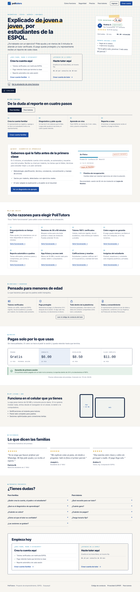
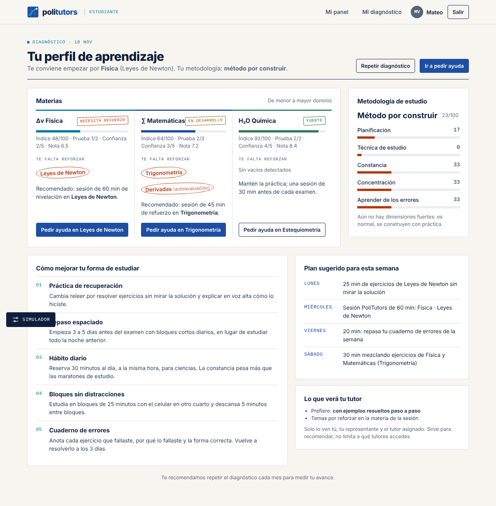
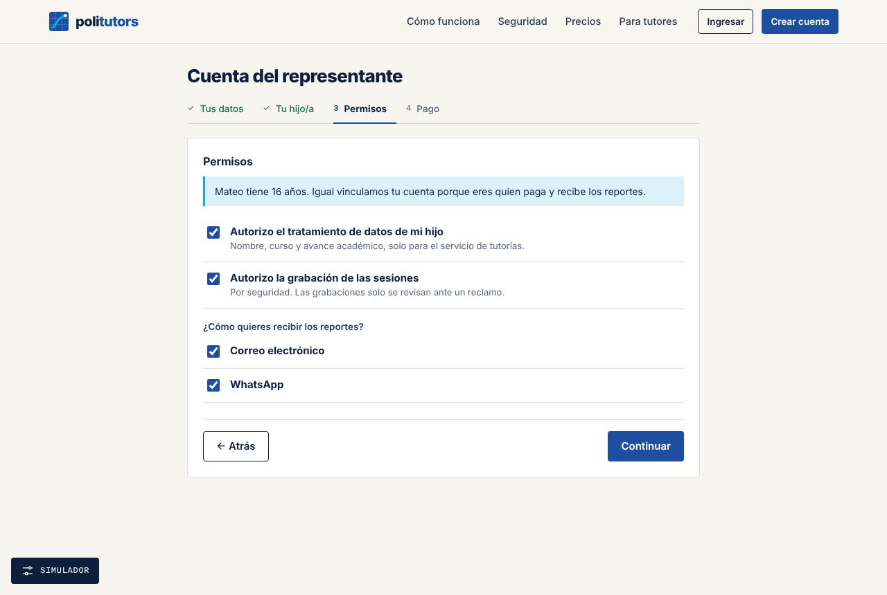
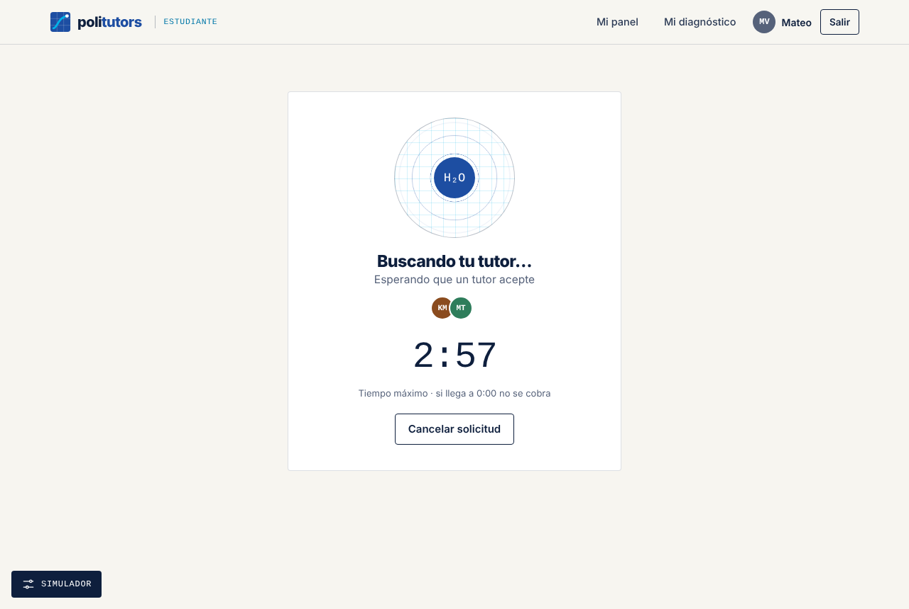
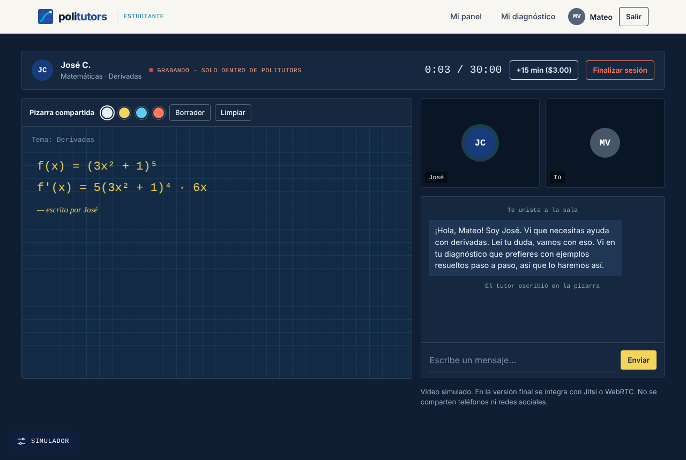
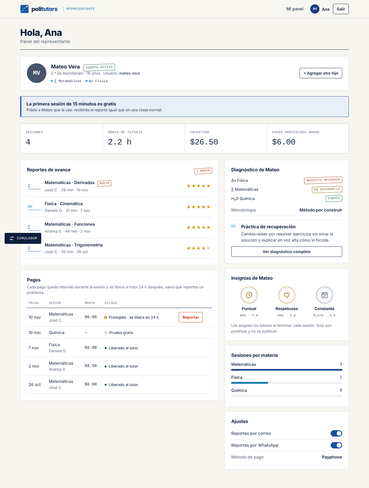
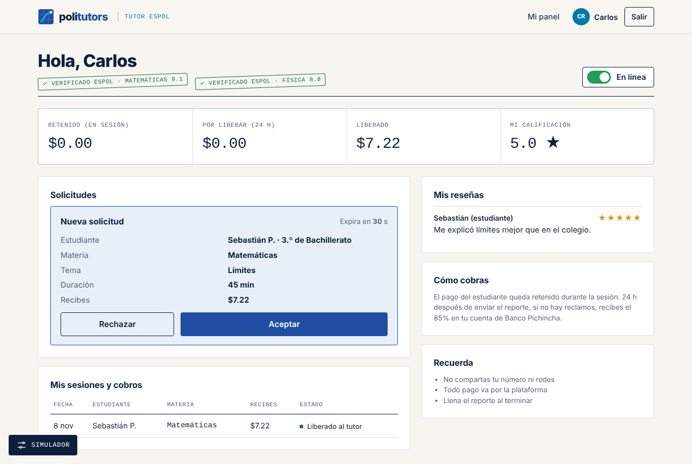
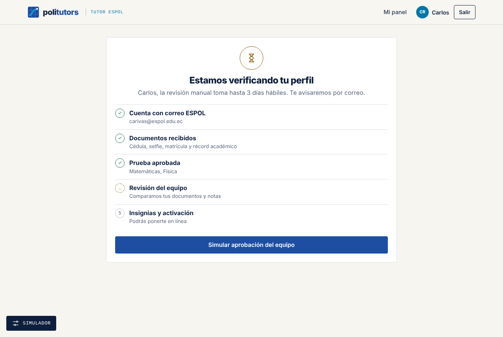
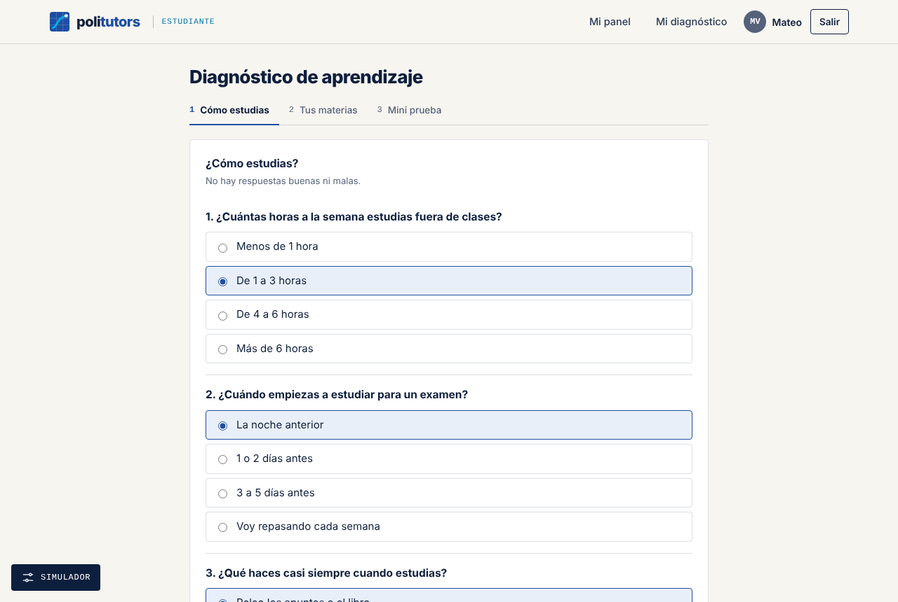

# PoliTutors · Prototipo web

Prototipo funcional de **PoliTutors**, una plataforma bajo demanda (*on-demand*) que conecta en tiempo real a estudiantes de bachillerato que necesitan apoyo en **Matemáticas, Física y Química** con **tutores universitarios verificados de la ESPOL**. El servicio garantiza cobros seguros y envía reportes automáticos de avance a los padres de familia.

> Proyecto académico de la materia de Emprendimiento · ESPOL · Guayaquil, Ecuador.
> La identidad visual («Cuaderno politécnico», basada en la colorimetría de la ESPOL) está documentada en [`DESIGN.md`](DESIGN.md).
> Es un **prototipo**: los pagos, el video y la subida de documentos son simulados.



---

## Contenido

- [Cómo abrirlo](#cómo-abrirlo)
- [Cómo presentarlo en 2 minutos](#cómo-presentarlo-en-2-minutos)
- [Estructura del sitio](#estructura-del-sitio)
- [Flujos por rol](#flujos-por-rol)
- [Diagnóstico de aprendizaje](#diagnóstico-de-aprendizaje)
- [El simulador](#el-simulador)
- [Simulación guiada (17 pasos)](#simulación-guiada-17-pasos)
- [Dónde ver cada atributo](#dónde-ver-cada-atributo)
- [Qué está simulado y supuestos de negocio](#qué-está-simulado-y-supuestos-de-negocio)
- [Identidad visual](#identidad-visual)
- [Cómo modificarlo](#cómo-modificarlo)
- [Estructura del código](#estructura-del-código)
- [Capturas](#capturas)

---

## Cómo abrirlo

Todo el prototipo está en **un solo archivo**: `index.html`. No necesita instalación, servidor ni base de datos.

**Opción 1: abrirlo directo**
1. Descarga el repositorio (botón verde **Code → Download ZIP**) y descomprímelo.
2. Haz doble clic en `index.html`. Se abre en tu navegador (Chrome, Edge, Firefox o Safari).

**Opción 2: con un servidor local** (opcional)
```bash
# desde la carpeta del proyecto
python3 -m http.server 8000
# abre http://localhost:8000
```

**Opción 3: publicarlo en GitHub Pages** para compartirlo con un enlace
1. En el repositorio ve a **Settings → Pages**.
2. En *Source* elige **Deploy from a branch**, rama `main` y carpeta `/ (root)`. Guarda.
3. En uno o dos minutos tendrás el enlace `https://<tu-usuario>.github.io/<nombre-del-repo>/`.
   *(En cuentas gratuitas, GitHub Pages requiere que el repositorio sea público.)*

> Necesita internet solo para cargar la tipografía (Google Fonts). Sin conexión funciona igual con la fuente del sistema.
> **Los datos se reinician al recargar la página.**

---

## Cómo presentarlo en 2 minutos

1. Abre `index.html`.
2. En la homepage, haz clic en **▶ Ver simulación de cómo funciona**.
3. Usa **Siguiente ▶** para avanzar paso a paso, o **▶ Auto** para que avance solo (~7 s por paso).
4. Al terminar, abre el botón **⚙ Simulador** (abajo a la izquierda) para explorar libremente con las cuentas de ejemplo.

---

## Estructura del sitio

```
Homepage (#inicio)
├── ¿Eres padre, madre o estudiante? → Crear cuenta familiar (#registro-familia)
│     ├── Lo crea el representante → datos → hijo/a → permisos → pago → Panel del padre (#padre)
│     └── Lo crea el estudiante → datos → representante → invitación (#invitacion) → aprobación
├── ¿Eres estudiante de la ESPOL? → Página para tutores (#tutores) → Registro de tutor (#registro-tutor)
│     └── cuenta → documentos → materias → prueba → código de conducta → revisión → Panel del tutor (#tutor)
├── Ingresar (#ingresar) → la misma pantalla para los tres roles
├── Diagnóstico de aprendizaje (#diagnostico) → test de 3 partes → perfil y recomendaciones
└── Secciones: Cómo funciona · Diagnóstico · 8 atributos · Seguridad · Precios · App + web · Testimonios · FAQ
```

Cada sección de la homepage:

| Sección | Qué muestra |
|---|---|
| Hero | Propuesta de valor y las **dos entradas**: familias y tutores |
| Cómo funciona | 4 pasos con pestañas *Para familias* / *Para tutores* |
| Diagnóstico de aprendizaje | Qué mide el test y un ejemplo de resultado |
| Ocho razones | Los 8 atributos, cada uno con “Verlo funcionando →” que salta a la simulación |
| Confianza y seguridad | Verificación, pago protegido, todo dentro de la plataforma, LOPDP, código de conducta |
| Precios | Prueba gratis de 15 min, $6 / $8.50 / $11 y la garantía de primera sesión |
| App liviana + web | Atributo 6 |
| Testimonios y FAQ | Testimonios ilustrativos y preguntas separadas para familias y tutores |

---

## Flujos por rol

### 👨‍👩‍👦 Representante (padre o madre)
1. **Registro:** nombre, correo, celular y contraseña.
2. **Hijo/a:** nombre, curso, fecha de nacimiento, colegio y materias de interés.
3. **Permisos:** consentimiento para el tratamiento de datos (LOPDP; obligatorio para menores de 15 años) y para la grabación de sesiones. Elige si recibe los reportes por correo y/o WhatsApp.
4. **Pago:** Payphone, Kushki o transferencia. No se cobra nada al registrarse.
5. Se generan el **usuario y la contraseña temporal del hijo**.
6. **Panel:** resumen del diagnóstico del hijo (nivel por materia, metodología y la recomendación principal, con un botón para ver el diagnóstico completo), reportes de avance (con marca de *Nuevo*), calificación del tutor como representante, tabla de pagos con estados, botón **Reportar** para pedir reembolso, insignias del hijo, sesiones por materia y ajustes de notificaciones.

### 🎒 Estudiante
- **Si lo registra el padre:** entra con el usuario que se le generó.
- **Si se registra solo:** ingresa sus datos y los de su representante. La cuenta queda **pendiente** (puede explorar, pero no pedir ayuda) hasta que el representante abre la invitación, la aprueba y registra un método de pago.
- **Diagnóstico de aprendizaje:** una franja en su panel le invita a hacerlo (ver la sección siguiente). Los temas que le faltan aparecen marcados como *por reforzar*.
- **Pedir ayuda:** materia → tema → descripción → **foto del ejercicio** (opcional) → duración (15 min gratis la primera vez, 30, 45 o 60 min).
- **Confirmación:** el cobro va a la cuenta del representante y queda **retenido**. Si no hay tutor en 3 minutos, no se cobra.
- **Emparejamiento:** cuenta regresiva de 3:00 y aviso a los tutores mejor calificados en esa materia.
- **Tutor encontrado:** perfil verificado, notas por materia, calificación y reseñas. Puede “Buscar otro tutor”.
- **Sesión en vivo:** pizarra compartida (dibujar, colores, borrador), chat interno, video simulado, indicador de grabación y botón **+15 min**, que pide aprobación al representante.
- **Cierre:** calificación obligatoria de 1 a 5 con etiquetas y comentario → el tutor completa el reporte → el reporte llega al representante.

### 🎓 Tutor ESPOL
1. **Página para tutores** con una calculadora de ingresos.
2. **Registro en 5 pasos:**
   - Cuenta con correo **@espol.edu.ec** (otros dominios se rechazan).
   - Documentos: cédula (frente y reverso), selfie con cédula, matrícula vigente y récord académico.
   - Materias con **nota mínima 8/10**.
   - **Prueba corta**: una pregunta por materia; debe acertar.
   - **Código de conducta** para trabajar con menores y banco donde recibe los pagos.
3. **En revisión:** línea de tiempo del proceso (hasta 3 días hábiles) → aprobación.
4. **Panel:** insignias “Verificado ESPOL” por materia, interruptor **En línea**, solicitudes con 30 s para aceptar, sesión en vivo, **reporte para el representante** (temas, observaciones y evaluación de puntualidad, respeto y constancia), dinero retenido, por liberar y liberado, y reseñas recibidas.

---

## Diagnóstico de aprendizaje

Un test de **5 minutos** que el estudiante hace desde **Mi diagnóstico** (menú superior) o desde la franja de su panel. Sirve para saber **cómo estudia** y **qué le falta** en cada materia, y con eso recomendarle cómo mejorar.



**Parte 1: Cómo estudias** (11 preguntas). Mide cinco dimensiones de metodología:

| Dimensión | Qué pregunta |
|---|---|
| Planificación | Cuándo empieza a estudiar para un examen y si organiza su semana |
| Técnica de estudio | Si relee o practica ejercicios, y si explica con sus palabras lo aprendido |
| Constancia | Horas de estudio a la semana |
| Concentración | Dónde está el celular y cuánto tiempo estudia sin distraerse |
| Aprender de los errores | Qué hace cuando no entiende algo y cuando le devuelven una prueba |

Además pregunta **cómo prefiere que le expliquen** y **cómo se siente antes de un examen**.

**Parte 2: Tus materias.** Para Matemáticas, Física y Química: última nota (opcional), confianza del 1 al 5 y temas que más le cuestan.

**Parte 3: Mini prueba.** 7 ejercicios cortos, cada uno asociado a un tema, con la opción **“No lo sé”** para no adivinar.

**Resultados:**
- **Nivel por materia** (*Fuerte*, *En desarrollo* o *Necesita refuerzo*). Combina la mini prueba (60%), la confianza (20%) y la nota (20%). Si no hay nota, usa 70% prueba y 30% confianza.
- **Te falta reforzar:** temas de los ejercicios fallados más los que marcó como difíciles. Estos últimos se indican como *(autoevaluación)*.
- **Sesión recomendada** por materia (60, 45 o 30 min según el nivel) con el botón **Pedir ayuda en…**, que deja lista la solicitud.
- **Perfil de metodología** (*Método sólido*, *en desarrollo* o *por construir*) con las cinco dimensiones de 0 a 100.
- **Cómo mejorar tu forma de estudiar:** técnicas para las dimensiones más bajas (práctica de recuperación, repaso espaciado, hábito diario, bloques sin distracciones, cuaderno de errores, simulacros con tiempo).
- **Plan sugerido para la semana**, armado con las materias más débiles.
- **Lo que verá el tutor:** cómo prefiere que le expliquen y sus temas por reforzar. El tutor lo usa al saludar en la sesión.

**Quién lo ve:** el estudiante, su representante (resumen en su panel y diagnóstico completo) y el tutor asignado. Se recomienda repetirlo cada mes con **Repetir diagnóstico**.

> Las preguntas, los pesos y las técnicas están en las constantes `DX_M`, `DX_T`, `METHOD_TIPS` y la función `computeDiag()` de `index.html`. Son una propuesta del prototipo y conviene validarlas con un orientador o docente.

---

## El simulador

El botón **⚙ Simulador** (abajo a la izquierda) es una herramienta para presentar el prototipo. **No forma parte del producto.**

| Opción | Para qué sirve |
|---|---|
| ▶ Simulación guiada | Inicia el recorrido de 17 pasos |
| Entrar como… | Cambia entre las cuentas creadas (representante, estudiante, tutor) sin cerrar sesión |
| Cargar cuentas de ejemplo | Crea a **Ana Vera** (representante), **Mateo Vera** (estudiante, con historial y diagnóstico) y **Carlos Rivas** (tutor verificado) |
| ⏩ Adelantar 24 h | Libera los pagos que estaban en la ventana de reclamo |
| ✉ Abrir invitación | Aparece cuando hay un estudiante pendiente de aprobación |
| ✓ Aprobar al tutor | Aparece cuando hay un tutor en revisión |
| Reiniciar todo | Borra todas las cuentas y vuelve al inicio |

**Cuentas de ejemplo** (si quieres usar la pantalla *Ingresar*):

| Rol | Usuario | Contraseña |
|---|---|---|
| Representante | `ana.vera@gmail.com` | `demo` |
| Estudiante | `mateo.vera` | `demo` |
| Tutor | `carivas@espol.edu.ec` | `demo` |

Las cuentas que crees tú mismo usan la contraseña que escribiste en el registro.

---

## Simulación guiada (17 pasos)

| # | Etiqueta | Qué se ve |
|---|---|---|
| 1 | Homepage | Las dos entradas: familias y tutores |
| 2 | Registro familiar | ¿Quién crea la cuenta? Padre o estudiante |
| 3 | Registro familiar | El padre agrega a su hijo |
| 4 | Seguridad | Consentimiento de datos (LOPDP) y grabación |
| 5 | Diagnóstico | Test de metodología y conocimientos |
| 6 | Diagnóstico | Resultados: qué le falta y cómo mejorar |
| 7 | Atributo 2 | Pedir ayuda: materia, tema, foto y duración |
| 8 | Atributo 1 | Emparejamiento en menos de 3 minutos |
| 9 | Atributos 3 y 7 | Tutor verificado con notas y reseñas |
| 10 | Atributo 2 | Sesión en vivo con pizarra y chat |
| 11 | Atributo 7 | Calificación obligatoria al cerrar |
| 12 | Atributo 5 | Reporte automático para el representante |
| 13 | Atributo 4 | Pago protegido con ventana de reclamo |
| 14 | Atributo 3 | Verificación del tutor (documentos, notas, prueba) |
| 15 | Oferta | El tutor se pone en línea y acepta solicitudes |
| 16 | Atributo 8 | Insignias positivas del estudiante |
| 17 | Atributo 6 | App liviana y acceso web |

Controles: **◀** anterior · **▶ Auto / ❚❚ Pausar** · **Siguiente ▶** · **✕** salir.
Desde la homepage, cada tarjeta de atributo tiene **“Verlo funcionando →”**, que abre la simulación en el paso correspondiente.

---

## Dónde ver cada atributo

| # | Atributo | Dónde se ve en el prototipo |
|---|---|---|
| 1 | Emparejamiento en tiempo real bajo demanda | Estudiante → *Pedir ayuda ahora* → pantalla de búsqueda con cuenta regresiva de 3:00 |
| 2 | Sesiones modulares de 30 a 60 min | Selector de duración (15 gratis, 30, 45 o 60) y botón **+15 min** dentro de la sesión |
| 3 | Perfil de tutor 100% verificado | Registro de tutor (correo ESPOL, documentos, nota ≥ 8, prueba) e insignias en el perfil del tutor |
| 4 | Esquema de cobro seguro | Confirmación (*retenido*) → *Protegido · se libera en 24 h* → *Liberado*; botón **Reportar** para reembolso |
| 5 | Reporte automático de avance para padres | Al cerrar la sesión: temas, próximos pasos y compromiso; panel del padre y aviso por correo/WhatsApp |
| 6 | App móvil liviana y acceso web | Sección *App liviana + web* y diseño adaptable a celular |
| 7 | Sistema de calificaciones y reseñas | Calificación obligatoria del estudiante, calificación del padre desde el reporte, reseñas en el perfil del tutor |
| 8 | Insignias y reputación del estudiante | Puntual, Respetuoso y Constante (Oro/Plata/Bronce), asignadas por el tutor; solo positivas y privadas |

---

## Qué está simulado y supuestos de negocio

**Simulado (no es real en este prototipo):**
- Pasarela de pago (Payphone, Kushki, transferencia): no se procesa ningún cobro.
- Videollamada: se muestran avatares. En la versión final se integraría Jitsi o WebRTC.
- Subida de documentos y fotos: los archivos no salen del navegador.
- Correos y mensajes de WhatsApp: solo se muestran como avisos.
- Tutores, reseñas, testimonios y cifras de la homepage: datos de demostración.
- Los datos se guardan en memoria y **se pierden al recargar**.

**Supuestos para validar con el equipo:**

| Supuesto | Valor en el prototipo |
|---|---|
| Precios por sesión | 15 min gratis (una vez) · 30 min $6.00 · 45 min $8.50 · 60 min $11.00 |
| Extensión | +15 min por $3.00 |
| Comisión de la plataforma | 15% (el tutor recibe el 85%) |
| Nota mínima del tutor | 8/10 en la materia |
| Ventana de reclamo | 24 h antes de liberar el pago |
| Tiempo para aceptar una solicitud | 30 s |

> **Nota técnica:** según la investigación previa, las pasarelas locales no ofrecen una retención tipo *escrow*, por lo que la retención se plantea como un registro contable interno de PoliTutors. Retener dinero de terceros debe validarse con un asesor legal y tributario.

---

## Identidad visual

El prototipo sigue el sistema **«Cuaderno politécnico»**, documentado en [`DESIGN.md`](DESIGN.md):

- **Colorimetría de la ESPOL:** azul institucional como único color de acción, celeste en la cuadrícula del cuaderno y en los gráficos, y grises plata. Se suma el tramado diagonal a 133° de la textura corporativa.
- **Tipografía libre latinoamericana:** Archivo para titulares e interfaz, Chivo Mono para cifras y etiquetas, y Alegreya itálica para las notas del tutor.
- **Tres registros visuales:** boletín para los padres, cuaderno para los estudiantes y **modo pizarra** oscuro para la sesión en vivo.
- **Sin el look de plantilla:** iconos SVG propios en lugar de emojis, hojas con filetes en lugar de tarjetas con sombra, sellos en lugar de píldoras de color, y ni degradados ni Inter.
- **Uso de la marca ESPOL:** el prototipo no usa el logotipo, el sello ni la tortuga de la ESPOL. Los códigos exactos de color del manual oficial están pendientes de confirmar; ver la nota en `DESIGN.md`.

---

## Cómo modificarlo

Todo se edita en `index.html`, dentro de la etiqueta `<script>`. Busca estas constantes:

| Qué cambiar | Dónde |
|---|---|
| Precios y duraciones | `const DURATIONS = [...]` |
| Precio de la extensión | `const EXT_PRICE = 3;` |
| Porcentaje que recibe el tutor | `const SHARE = 0.85;` |
| Materias y temas | `const SUBJECTS = {...}` |
| Tutores de ejemplo | `const TUTORS = [...]` |
| Solicitudes que recibe el tutor | `const REQS = [...]` |
| Preguntas de la prueba del tutor | `const QUIZ = {...}` |
| Preguntas del diagnóstico | `const DX_M = [...]` (metodología) y `const DX_T = [...]` (mini prueba) |
| Técnicas de estudio recomendadas | `const METHOD_TIPS = {...}` |
| Pesos y niveles del diagnóstico | `function computeDiag()` |
| Pasos de la simulación guiada | `const TOUR = [...]` |
| Colores de la marca | Variables `--azul`, `--celeste`, `--paper`, `--ink`, etc. al inicio de `<style>` (ver `DESIGN.md`) |

---

## Estructura del código

Es una *single-page application* hecha con **HTML, CSS y JavaScript sin librerías**. La navegación usa el `#hash` de la URL.

```
index.html
├── <style>          Estilos (variables de color, componentes y diseño responsive)
└── <script>
    ├── Utilidades    Formato de dinero, fechas, estrellas, avatares
    ├── Datos         SUBJECTS, DURATIONS, TUTORS, REQS, QUIZ, OBS…
    ├── Estado (S)    Cuentas (parent, child, tutor), reportes, pagos, flujo actual
    ├── Vistas        VIEWS.inicio, tutores, registro-familia, registro-tutor,
    │                 ingresar, invitacion, estudiante, diagnostico, padre, tutor
    ├── Diagnóstico   DX_M, DX_T, computeDiag(), diagHTML()
    ├── Sala en vivo  Pizarra (canvas), chat y temporizador, compartidos por estudiante y tutor
    ├── Acciones      ACT: manejadores de clics mediante data-act="..."
    ├── Simulación    TOUR: los 17 pasos de la simulación guiada
    └── Router        route(), go(), render()
```

---

## Capturas

| | |
|---|---|
| **Registro familiar: permisos**<br> | **Emparejamiento**<br> |
| **Sesión en vivo**<br> | **Panel del representante**<br> |
| **Panel del tutor**<br> | **Verificación del tutor**<br> |
| **Diagnóstico: test**<br> | **Diagnóstico: resultados**<br> |
